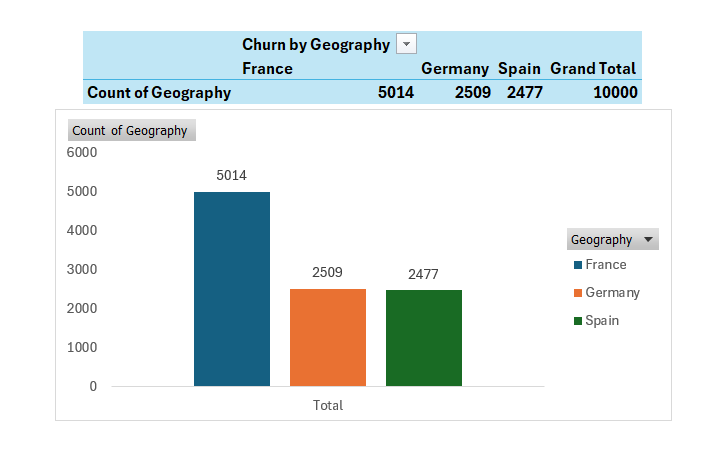
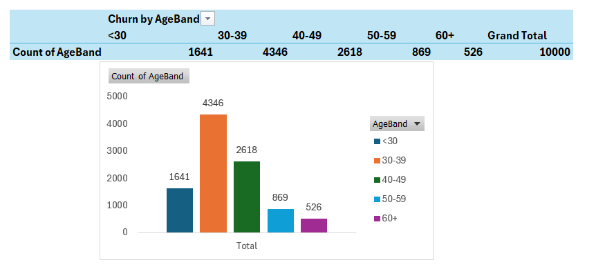
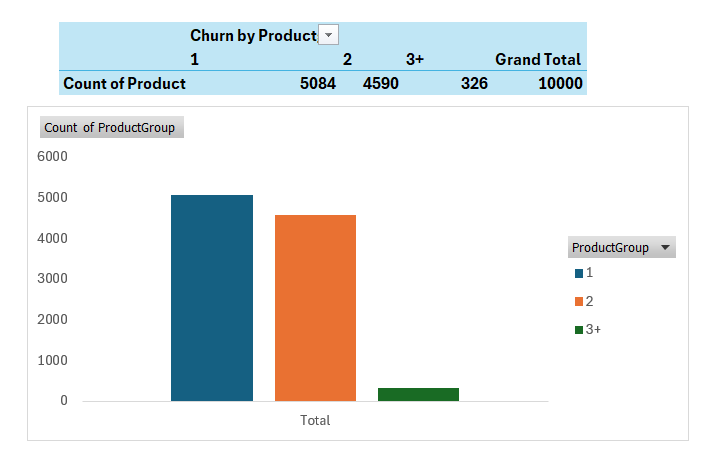

# Excel Profiling: Bank Churn

**Workbook:** `Bank_churn_prediction.xlsx`  
**Source:** `data/raw/bank_churn.csv`  
**Date downloaded:** *Add your download date*  
**Expected rows:** Approximately 10,000  
**Excel table:** `tblBank`

## Overview

Excel was used to profile the Bank Customer Churn dataset, validate data quality, create customer segments, and explore churn patterns before proceeding to MySQL analysis and Python machine learning.

The original dataset was kept unchanged and imported through **Data → From Text/CSV**.

## Sheets

| Sheet | Purpose |
|---|---|
| `README` | Dataset source, download date, and workbook documentation |
| `tblBank` | Customer data stored in an Excel Table, including derived columns |
| `DQ_Checks` | Row count, churn rate, blanks, zero balances, duplicate IDs, minimum and maximum values, and product-count checks |
| `Pivots` | Seven PivotTables for customer segmentation and churn analysis |
| `Charts` | Column charts created from selected PivotTables |

## Derived Columns and Cut-offs

| Column | Cut-offs / Logic | Purpose |
|---|---|---|
| `AgeBand` | Below 30, 30–39, 40–49, 50–59, 60+ | Compare churn across age groups |
| `HasZeroBalance` | Balance = 0 → 1; otherwise 0 | Identify zero-balance customers |
| `BalanceBand` | Zero, 1–99K, 100K+ | Compare balance segments |
| `TenureBucket` | 0–1, 2–4, 5–7, 8–10 years | Explore customer tenure |
| `ProductsGroup` | 1, 2, 3+ | Combine customers holding three or four products |
| `CreditBand` | Below 580, 580–669, 670–739, 740+ | Compare credit-score segments |

The balance and credit-score cut-offs are analytical conventions. The product groups combine three or more products to reduce the impact of small segment sizes.

## PivotTable Analysis

The PivotTables use **Average of `Exited`**, formatted as a percentage, to calculate churn rates and **Count of `CustomerId`** to show segment sizes where applicable.

1. **Churn by Geography** — compares churn across countries.
2. **Churn by Gender** — compares churn between gender groups.
3. **Churn by AgeBand** — examines age-related churn patterns.
4. **Churn by ProductsGroup** — compares churn by number of products held.
5. **IsActiveMember × Geography** — examines customer activity across countries using conditional formatting.
6. **Balance Held** — compares the sum of customer balances by churn status.
7. **BalanceBand** — compares customer balance groups.

## Key Visualizations

### 1. Churn by Geography

Compares customer churn rates across geographical regions.

### 2. Churn by AgeBand

Shows churn rates across customer age groups.

### 3. Churn by ProductsGroup

Compares churn across product-count groups, with customer counts labelled for context.

## Verification

- Confirm that the Excel row count matches the source CSV.
- Check that customer IDs are unique.
- Compare the overall churn rate with the SQL result and the Python result.
- Verify that the PivotTable grand total for Average of `Exited` matches the overall churn rate.
- Review customer counts alongside churn rates to avoid misleading conclusions from small groups.
- Refresh PivotTables after changing the source data.

## Findings

*Complete this section after validating the actual workbook results.*

- **Overall churn rate:** Add calculated percentage.
- **Highest-churn geography:** Add result.
- **Age band where churn starts climbing:** Add result.
- **Product-count pattern:** Add result.
- **Zero-balance customer share and churn rate:** Add results.

## Pitfalls Avoided

- Used average churn rate instead of summing the `Exited` values in PivotTables.
- Reviewed customer counts alongside churn rates.
- Refreshed PivotTables after source changes.
- Avoided `SUMPRODUCT(COUNTIF(range,range))` for duplicate checks because it can be slow on larger ranges.
- Treated customer balances as account balances, not bank revenue.

## Conclusion

Excel provided an initial view of customer churn, customer segmentation, and data quality. These checks and visualizations establish a foundation for deeper SQL analysis and Python-based exploratory data analysis and machine learning.

## Next Phase

**MySQL — Data Loading, Data Quality, and Customer Churn Analysis**

